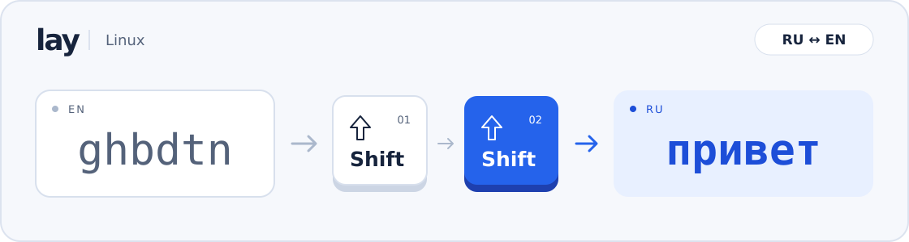

<div align="center">

# Lay

### Два Shift — и слово на месте.

Помощник русского и английского ввода для Linux.<br>
Исправляет раскладку последнего слова, помогает с набором и работает локально.

<a id="english"></a>

**[Установить](#install)** · [Возможности](#features) · [Совместимость](#compatibility) · [English](README.en.md)

[](https://github.com/radislabus-star/lay-public/releases/latest)
[](#compatibility)
[](LICENSE)

<a id="demo"></a>

<picture>
  <source media="(prefers-color-scheme: dark)" srcset="docs/publicity/readme-hero-dark.svg">
  
</picture>

<sub>Иллюстрация ручного исправления раскладки.</sub>

</div>

Набрали `ghbdtn` вместо `привет`? Дважды быстро нажмите **левый Shift**.
Lay исправит последнее слово прямо в поле ввода. В другую сторону так же:
`руддщ` → `hello`.

По умолчанию вы сами решаете, когда исправить слово. Автопомощь и автозамена
включаются отдельно. Для обычной работы не нужны облачная модель, API-ключ или подписка.

<a id="install"></a>

## Установка и первый запуск

Основная среда — **Ubuntu / GNOME Wayland**, языки — **русский и английский**.
Проект в стадии **alpha**: перед установкой посмотрите [совместимость](#compatibility).

### 1. Установите Lay

```bash
curl -fsSL https://raw.githubusercontent.com/radislabus-star/lay-public/main/scripts/install-remote.sh |
  LAY_KEEP_OLLAMA=1 bash
```

Это **установка из исходников**: нужны интернет, права `sudo` и время на сборку.
[Установщик](scripts/install-remote.sh) добавляет системные зависимости, устанавливает
Rust при его отсутствии и скачивает данные для работы Lay. Если Rust уже установлен,
нужна версия **1.88 или новее**.

`LAY_KEEP_OLLAMA=1` сохраняет вашу Ollama и её модели: без этого параметра в установщике
срабатывает очистка старых установок Ollama.

<details>
<summary>Другие дистрибутивы и первый вход в сессию</summary>

Установщик распознаёт `apt`, `pacman`, `dnf`, `yum` и `rpm-ostree`.
Наличие установщика для дистрибутива не означает, что все его приложения проверены.

На **Bazzite / Fedora Atomic** после добавления зависимостей через `rpm-ostree`
потребуется перезагрузка. Затем повторите команду выше.

Доступ к устройствам ввода выдаётся активной локальной сессии через `udev`/`logind`;
вручную добавлять себя в группу `input` не нужно. Для первоначальной интеграции
с рабочим столом может потребоваться выйти из сессии и войти снова.

По умолчанию исходники находятся в `~/projects/lay`.

</details>

### 2. Исправьте первое слово

Включите русскую и английскую раскладки. В английской раскладке наберите `ghbdtn`
в обычном текстовом поле и дважды быстро нажмите **левый Shift**.
Ожидаемый результат — `привет`.

### 3. Выберите, сколько помощи нужно

Откройте меню Lay в панели. Ручное исправление работает по умолчанию;
**«Помощь при наборе»** и **«Автозамена»** включаются отдельно.
Для подсказок прямо в строке и их принятия клавишей **Tab** нужен режим ввода Lay/IBus.

<a id="features"></a>

## Как Lay помогает при наборе

- **Исправить раскладку.** Два нажатия левого **Shift** переворачивают последнее слово RU ↔ EN. Работает по умолчанию.

- **Исправлять во время набора.** Автопомощь проверяет слово на границе и может исправить раскладку или подтверждённую опечатку. Автопомощь и автоматическая замена включаются отдельно.

- **Дописать слово.** Lay показывает продолжение; **Tab** принимает актуальную подсказку и добавляет пробел. Нужен активный ввод через Lay/IBus.

- **Сохранить смешанный текст.** Режим **Smart** учитывает слова обеих раскладок: `good ntrcn` → `good текст`. Его можно выбрать в меню.

В меню также доступны прямой выбор RU/EN и настройка горячих клавиш.
Подсказки могут учитывать подтверждённые решения и доступный контекст;
в распознанном терминале — отдавать приоритет подходящим командным продолжениям.
Принятие подсказки **не запускает команду**.

<details>
<summary>Конвертация текста в терминале и скриптах</summary>

```bash
lay "ghbdtn"
# привет

lay "руддщ цщкдв"
# hello world

printf '%s\n' 'ghbdtn' | lay
# привет
```

CLI конвертирует переданную строку или текст из стандартного ввода.

</details>

<a id="faq"></a>
<a id="compatibility"></a>

## Совместимость

| Окружение | Текущее состояние |
| --- | --- |
| **Ubuntu / GNOME Wayland** | Основная среда разработки; наиболее проверенный вариант |
| **KDE / Plasma Wayland** | Есть интеграция; проверенных сценариев меньше |
| **Niri Wayland** | Есть интеграция через `niri-ipc`; требуется дополнительная проверка |
| **X11** | Экспериментальный backend XKB |
| **Другие окружения** | Поддержка пока не заявлена |

Расширение GNOME заявляет версии **45, 46, 47 и 50**.
Сейчас поддерживается только пара **RU/EN**.

Работа зависит и от конкретного поля: браузеры, редакторы и терминалы по-разному
обрабатывают ввод. Основной сценарий — исправление недавно набранного слова.
Произвольное выделение, слово под перемещённым курсором и весь документ
не являются универсально поддерживаемой областью исправления.

Lay пока не обещает полноценную проверку русской грамматики или одинаковую работу
во всех приложениях. Актуальные изменения и известные ограничения — в
[релизах](https://github.com/radislabus-star/lay-public/releases).

<a id="privacy"></a>

## Что происходит с вашим текстом

- **Обработка на компьютере.** Обычный маршрут ввода работает локально; облачная LLM по умолчанию выключена.
- **Локальная память.** Включённые функции обучения могут сохранять подтверждённые исправления и историю использования на устройстве.
- **Диагностика по выбору.** Обычный маршрут не ведёт полный журнал нажатий. Отдельно включённые диагностические журналы могут содержать текст.

Для распознавания двойного Shift и последнего слова демон читает клавиатурные
события. Настройки хранятся в `~/.config/lay/config.json`.

## Обновление и удаление

<details>
<summary><strong>Обновить Lay</strong></summary>

Выберите **«Проверить обновления»** в меню Lay. Откроется терминал с ходом проверки;
перед сборкой и установкой будет запрошено подтверждение.

Или запустите установленную команду:

```bash
lay-update --menu
```

Обновление использует исходную папку установки, сохраняет пользовательские
настройки и найденные изменения исходников в именованный `git stash`.
Если локальная и удалённая история разошлись, обновление останавливается.

</details>

<details>
<summary><strong>Удалить программу, сохранив настройки</strong></summary>

Для стандартной папки установки:

```bash
cd ~/projects/lay
bash uninstall.sh
```

Настройки, память и исходники останутся. Если при установке была выбрана другая
папка, используйте её.

</details>

<details>
<summary><strong>Удалить Lay вместе с его данными</strong></summary>

```bash
cd ~/projects/lay
bash uninstall.sh --purge
```

Удаляются также настройки, память, кэши, логи и чистая копия исходников Lay.
Локально изменённый checkout автоматически не удаляется.

</details>

<a id="docs"></a>
<a id="feedback"></a>

## Обратная связь и разработка

**[Сообщить об ошибке](https://github.com/radislabus-star/lay-public/issues/new)**
или [посмотреть открытые задачи](https://github.com/radislabus-star/lay-public/issues).

В сообщении помогут версия Lay, дистрибутив, рабочее окружение, приложение
и короткий пример «набрал → ожидал → получил». Не прикладывайте личный текст
или журналы с чувствительными данными.

| Если хотите… | Начните здесь |
| --- | --- |
| Понять устройство Lay | [Как это работает](HOW_IT_WORKS.md) |
| Изменить код | [Разработка и проверки](DEVELOPMENT.md) |
| Разобраться в архитектуре | [Архитектурные правила](ARCHITECTURE.md) |
| Найти технический документ | [Навигация по документации](docs/README.md) |
| Посмотреть историю проекта | [Изменения версий](VERSIONING.md) |

<a id="license"></a>

## Лицензия

**Бесплатно для некоммерческого использования**: личных задач, обучения,
исследований и тестирования. Для коммерческого использования требуется отдельное
письменное разрешение правообладателей. Условия — в [Lay Non-Commercial License](LICENSE).
