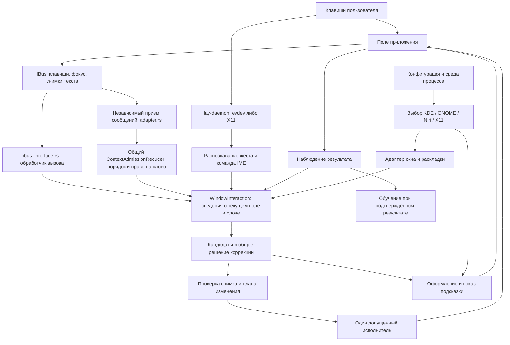
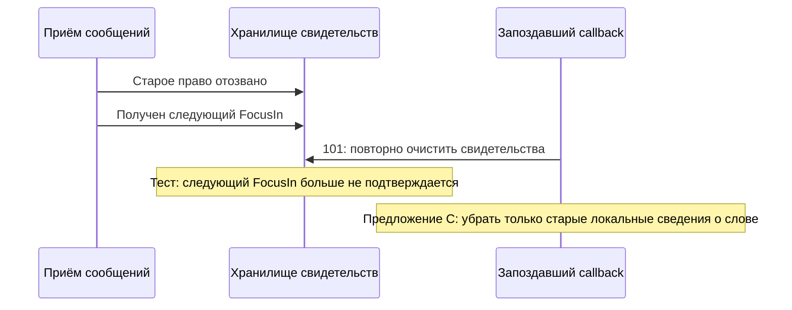

# Карта влияния ввода Lay перед изменением общего обработчика

Дата документа: 2026-10-27. Срез работающих процессов: 2026-10-26T22:59:23Z.
Это анализ реализованного кода, а не новый архитектурный контракт и не акт
приёмки всех приложений. Канон: `ARCHITECTURE.md`, прежде всего C01, C03,
C04, C06–C10. До завершения карты новые runtime-правки и установки приостановлены.
После карты пользователь разрешил правку, проверки и релиз при успешной проверке.

## 1. Какие версии сравниваются

| Объект | Точная идентичность | Что это доказывает |
|---|---|---|
| Публичная 1.0.101 | тег `v1.0.101`, commit `9b83e9ee2d3efbe9bbf5e52d322633a989599b33` | Исходник опубликованной версии |
| Исходный обработчик 101 | SHA-256 `2db5e35cf272f771ec9aee6b3eaba3ee44ff1419cc784287cd619a6203f10c36` | Совпадает с файлом в диагностическом воспроизведении |
| Кандидат B | commit `f5dd7e1a105e759316f86af61389615ca6df72ce` | Предыдущая общая правка, отклонённая для публикации |
| Запущенный тестовый IME KDE | PID 3695756, SHA-256 `3ffc8e5ce9d14147bcc1d9b0bf66544b87f1112bdb1a3bdf145fdca2d04a2807` | На момент среза работает B, а не C |
| Системный IBus тестовой KDE | PID 3168326, SHA-256 `cb8ccaffcfcd09f107a84edd982a8b16f55ba45af4458a4e9c45541bcd4217e5` | Отдельный процесс, который нельзя считать перезапущенным из-за замены IME |
| Эксперимент C | отдельный checkout `/home/ubu/projects/lay-revocation-isolated-20261027`, ветка `codex/revocation-isolated-20261027` | Изоляция разработки; сама по себе не ограничивает runtime одним приложением |
| Проверенный исходник C | 1289 файлов/режимов, closure `e72574e997f6e4494ef3647e2b2b9f43826ac2b4bd72240c37c45ede57f5cbf2` | Завершённые исходные проверки и 10 release-артефактов; C ещё не установлен |
| Локальный IME пользователя | PID 3037150, загруженный SHA-256 `1095c2648bb59e2f4363a3f58394013e6b6598eb9d8678f5b0fb98a01cd90ebc` | Реальные байты из `/proc/PID/exe`; путь помечен `(deleted)`, поэтому установленный файл не равен загруженному процессу |

Основной принятый checkout остаётся
`/home/ubu/projects/lay-browser-final-fixes-20261018`.
Его пять незакоммиченных файлов сохранены; общего reset/отката не делали.
Полный patch C и проверка переноса:
`/home/ubu/.cache/lay/development/release-1.0.102-20261026/c/isolation/receipt.json`.
Срез процессов и завершённых gates:
`.../c/isolation/map-runtime-and-completed-gates.json`.

## 2. Общая схема: наблюдение, решение и вывод — разные этапы

Схема не означает, что каждый символ обязательно проходит через все блоки.
Обычный ввод, Double Shift, принятие окончания по Tab и исправление на Space
имеют разные основания. Право изменить именно выбранное поле проверяется общим
контуром. Показ подсказки не предоставляет такого права.

## 3. Файлы и реальная область действия

Пути ниже относительно корня checkout. Числа строк относятся к исходнику C;
при последующих изменениях находить функцию по имени, а не доверять номеру.

| Участок | Файл и ориентир | За что отвечает | Где действует |
|---|---|---|---|
| Запуск IME | `src/bin/lay_ibus_engine.rs`, `server.rs:180`, `factory.rs:23` | Подключение к IBus, независимый наблюдатель, создание экземпляров движка | Все клиенты этого процесса IME |
| Приём физических клавиш демоном | `src/bin/lay_daemon/native_input.rs:11`, `native_input/x11.rs`, `keyboard_io.rs` | Устройства evdev либо клавиатура X11; вывод через соответствующее устройство | Определяется выбранным транспортом; это не выбор браузера |
| Внешний Double Shift | `src/bin/lay_daemon/layout_controller/ime_bridge.rs` | Передаёт запрос и повторно проверяет точный IME-хвост/поле | Общий мост; разрешение связано с конкретным запросом |
| Вызовы IBus | `src/bin/lay_ibus_engine/ibus_interface.rs:21` | `ProcessKeyEvent`, FocusIn/Out, Reset, Disable, capabilities, снимки | Все приложения, подключённые к этому IME |
| Приём раньше выполнения callback | `context_admission/adapter.rs:3189`, `process_next:3202` | Фиксирует подлинное сообщение и порядок, обновляет reducer | Общий для подключённых экземпляров движка |
| Право на поле и слово | `context_admission.rs`, `context_admission/adapter.rs` | Идентичность владельца, поколения, допуска и наблюдения | Общее правило безопасности, не браузерная настройка |
| Сведения о поле/слове | `window_interaction/observation.rs` | Принимает наблюдения, согласует callback с уже полученными событиями | Общий IME; именно здесь спорная правка |
| Выбор допустимого вывода | `window_interaction/authority.rs:11,55` | Выбирает только возможности, доказанные для поля | По возможностям поля, не по имени приложения |
| Исполнение | `window_interaction/execution.rs:84,113` | Повторно проверяет допуск и запускает единственного исполнителя | Общий контур с конкретным допуском |
| Незаконченный набор | `engine.rs`, `state.rs`, `composition_commit.rs`, `composition_edit.rs` | Локальное состояние набора и явное принятие окончания | Общее состояние; режим зависит от возможностей клиента |
| Уже введённый текст | `committed_tail.rs`, `tail_memory.rs` | Ограниченный наблюдавшийся хвост, ревизии, результат исправления | Общее правило; зеркало не заменяет снимок документа |
| Кандидаты/автокоррекция | `preedit.rs`, `precognition_worker.rs`, `space_autocorrect_prefetch.rs`, `src/ime_correction.rs` | Подготовка предложения с существующими общими источниками кандидатов | Общее, с привязкой к снимку ввода |
| Выбор действия | `src/typing_transition/decision.rs:61` и его подмодули | `TransitionDecisionCore`; одно решение | Общее ядро коррекции; не меняется в этой задаче |
| План и право исполнения | `src/text_edit/gate.rs`, `executor.rs:108,139`, `structural_verifier.rs` | Проверяет переход и выдаёт `AuthorizedEdit` | Общее; нельзя ослаблять ради отдельного клиента |
| Double Shift внутри IME | `shift.rs:15,25` | Преобразование выбранного источника с точным допуском | Общее; исполнитель зависит от доказанного источника |
| Согласование раскладки | `layout_sync.rs:43,105,466,538` | Порядок смены режима, рабочая очередь, проверка устаревания | Общее управление, отдельный транспорт среды |
| Базовые сигналы вывода | `output.rs:197,268,300,331,382,433` | Preedit, auxiliary, CommitText, DeleteSurroundingText, InputMode | Общий сериализатор/вывод; Legacy и Atomic — разные представления |
| Геометрия и проекция подсказки | `hint_view.rs:20,31,97` | Только отображение окончания и координаты | Не владелец текста и не подтверждение редактирования |
| Выбор вида подсказки | `display.rs:27` | Выбирает профиль выбранной среды | Ветвление KDE/GNOME/Niri/X11 |
| Границы оформления | `text/attrs.rs:26` | Набранный диапазон и диапазон окончания, цвета и underline | Общая сериализация; ошибка диапазона может задеть все профили |
| KDE-оформление | `kde/display/common.rs` | Auxiliary, чёрный текст на белом фоне, underline 0 | Только когда общий диспетчер выбрал KDE |
| Chrome-особенность KDE | `kde/display/chrome.rs:8,17` | Допуск определённой presentation-возможности и бюджет активации по фактическому executable | Только канонический KDE и процесс `chrome` у вызывающего адаптера |
| GNOME-оформление | `gnome/display.rs` | Inline; существующий серый профиль | Только профиль GNOME; в этой правке файл не меняется |
| Настоящее поле через accessibility | `kde/native_document.rs:138,406,814` и подмодули | Чтение/сопоставление поля и точного диапазона, наблюдение результата | Условия KDE, текущего поля, владельца и возможностей; не вся папка Chrome-only |
| Нормализация отображённого пробела | `kde/native_document/client_presentation.rs` | Сравнивает полное наблюдение и конкретный ранее выведенный пробел | Только подходящее текущее native-поле; не общий допуск по сходству текста |
| KDE-наблюдение стирания | `kde/native_erasure.rs:8` | Форма ожидаемого снимка после наблюдавшегося удаления | Явная проверка KDE; сама форма не разрешает правку |
| Активное окно | `window_interaction/desktop.rs:31`, `kde/desktop.rs`, `gnome/desktop.rs` | Один выбранный адаптер среды | KDE не повторяет запрос через GNOME после отказа |
| Выбор среды | `src/config/active.rs:30`, `src/desktop.rs:25` | Явная настройка, затем окружение процесса | Общий выбор; неправильная среда процесса выбирает неправильный профиль |
| Фокус со стороны демона | `src/bin/lay_daemon/focus_guard.rs:135`, `kde_focus.rs` | Наблюдение текущего окна для демона | Отдельный потребитель выбранного desktop-адаптера |

## 4. Где действительно разделены KDE и GNOME

`LayConfig::active_layout_backend` вызывает единственный существующий
`resolve_layout_backend`: явное значение `layout_backend` имеет приоритет,
затем читаются `XDG_CURRENT_DESKTOP`, `DESKTOP_SESSION`, `XDG_SESSION_TYPE`.
Если информация отсутствует, текущий default — GNOME. Это уже реализованное
поведение, а не предложение нового fallback.

Выбранная среда определяет оформление, наблюдение активного окна и транспорт
смены раскладки. Общие сведения о слове, допуск, проверка плана, обучение и
обработчики FocusOut/Disable этой границей не разделены.

Папка не равна области влияния. Например, `kde/native_document.rs` импортирован
через `#[path]` в `window_interaction`, однако его исполнение дополнительно
проверяет каноническую KDE. В `kde/display/chrome.rs` есть проверка фактического
executable; общий обработчик FocusOut/Disable такой проверки не содержит.

Также существуют явные старые совместимые ветки Niri/X11 через GNOME-протокол
наблюдения. Они не означают автоматический переход KDE→GNOME при ошибке и не
должны незаметно меняться при этой правке.

## 5. Способ доставки текста: что уже есть и что менять не требуется

`TextTargetDecision::from_facts` выбирает в текущем порядке:

1. `CommitOnly`, если удалять ничего не требуется.
2. `NativeRangeCommit`, если доказан текущий native-диапазон.
3. `ExactSurroundingText`, если клиент дал соответствующую возможность.
4. `TerminalErase`, если доказан отдельный терминальный исполнитель.
5. `Unsupported`, если доказательства нет.

Дополнительно `TextTargetAuthority` различает активную композицию, Atomic,
делегирование точного IME-хвоста, делегирование буфера демона и отказ.
Это перечень существующих вариантов, а не разрешение взаимно подменять их.
`execute_local` и `execute_manual_toggle` перепроверяют допуск перед исполнением.

В спорном C **не меняются** этот выбор, `EngineOutput`, bridge wire-протокол,
`AuthorizedEdit`, verifier, native range / surrounding / terminal executors.
Однако изменение допуска раньше исполнения способно изменить, будет ли
существующий исполнитель вообще вызван. Поэтому отсутствие diff в delivery
не доказывает отсутствие пользовательского влияния.

## 6. Точная цепочка спорного события

Два обработчика: `observe_context_focus_out` (ветка около 425) и
`observe_context_disable` (ветка около 512), файл `observation.rs`.

Наблюдатель приёма уже отозвал право на старое слово и записал это для точного
владельца. Следующий FocusIn уже получен. Затем выполняется callback старого
события. `revocation_matches` проверяет именно этот отзыв и владельца.

В 101 callback снова вызывает `revoke_context_word`. Через
`ContextAdmissionAdapter::revoke_current_owner:2168` это вызывает
`malformed_or_unobserved_lifecycle` и `shared.stamps.revoke()`. В заданной
тестом очередности теряется и уже полученное свидетельство нового FocusIn.

Обычный неизвестный/неподтверждённый callback должен по-прежнему идти через
строгий отказ. Предложение касается только двух веток с уже проверенным отзывом.

**Это пока воспроизведение порядка сообщений в тесте.** Для него не установлены
клавиши/окно KDE, которые гарантированно вызывают тот же порядок. Потеря букв,
исчезновение подсказки или отказ конкретного Double Shift в пользовательском
окне этим тестом не доказаны. Нельзя относить все browser FAIL к этому механизму.

## 7. Побочные действия существующих функций

| Функция | Что изменяет | Что важно сохранить |
|---|---|---|
| `retire_context_word_locally` | Свидетельство границы слова, подтверждения отпущенной native-буквы, точный manual snapshot, reset-rereceipt, допуск к слову, локальный token, ожидающее обучение, подготовленное окончание | Сохраняет `context_owner` и выбранное поле; это сведения для нового чтения, не право использовать старое слово |
| `clear_preedit_completion_state` (`engine.rs:276`) | Окончание, кандидаты, цели замены, индекс, подготовленный кадр и candidate tracking | Не выдаёт команду удаления документа; дальнейшая публикация зависит от общего цикла |
| `strip_legacy_word_preedit_mirror` (`engine.rs:294`) | Убирает локальную композицию и её совпадающий хвост; сбрасывает cursor/legacy-флаги; перестраивает fast-буфер | Возвращает `true` только если действительно снята старая композиция; сам не посылает CommitText/Delete |
| `revoke_context_word` | Всё локальное выше; при соответствующем владельце также общий отзыв в adapter/stamps | Нужен для неизвестных/неподтверждённых событий; нельзя заменять повсюду локальной очисткой |
| `discard_context_activation` (`observation.rs:2416`) | Сбрасывает локального владельца и допуски; при совпадении поколения очищает shared active_path, handoff-буфер, focus-receipt, suppression | Это сильнее отзыва слова; B ошибочно использовал его при всё ещё выбранном поле |
| `reset_for_ibus_soft_reset` (`state.rs:392,398`) | Общая очистка композиции/жестов/ожидающих операций; при снятой композиции также восстанавливает factory-режим | Ранняя очистка композиции меняет результат внутренней проверки; поэтому A пропускал восстановление режима |
| `set_layout_is_ru` (`engine.rs:70`) | При изменении режима отменяет native-restoration learning и меняет layout_generation | Это локальное состояние декодера; функция сама не переключает системный источник |
| `cancel_native_autocorrection_restoration` (`tail_memory.rs:497`) | При действующей native-restoration снимает pending learning | Не обучение модели и не очистка пользовательской базы |
| `finish_focus_out` (`observation.rs:6455`) | Обычная очистка ухода из поля, terminal receipts и соответствующего shared active_path | Должна по-прежнему выполняться; локальное снятие слова не должно оставлять старое поле выбранным после реального blur |

Любая из первых двух спорных веток доступна различным IBus-клиентам в KDE и
GNOME. Изоляция веткой Git не меняет эту область действия. Для общей правки
нужны общие отрицательные контроли и физическая проверка заявленного охвата.

## 8. Что измерено у A, B и C

| Проверка | Факт | Практический предел |
|---|---|---|
| Неизменённый обработчик 101 | Два новых P2P-теста: 0 PASS / 2 FAIL на потере уже полученного FocusIn | Не инструкция ручного воспроизведения |
| A | Исходные/сборочные проверки пройдены; KDE full 301 PASS / 61 FAIL / 78 BLOCKED из 440 | Отклонён: отдельный тест доказал пропуск factory-режима |
| B | Исходные/сборочные проверки пройдены; KDE full 295 PASS / 67 FAIL / 78 BLOCKED из 440 | Отклонён: отдельный тест доказал потерю выбранного поля без нового FocusIn |
| C | 3523 correctness/package, 11 performance, lints/MSRV и 10 release-артефактов; исходный прогон завершён | Нет физической приёмки C; C не установлен |

Исторические native-таблицы нельзя складывать, переименовывать или переносить
на C. Корректная оценка новой сборки требует одинакового manifest/темпа/среды
и сохранения индивидуальных строк, включая потерянные PASS.

## 9. Варианты следующего действия

Оценки — инженерное решение по текущим данным, не результат теста.

| Вариант | Оценка | Причина |
|---|---|---|
| C: исправить только два проверенных отзыва в общем владельце; сохранить обычный lifecycle и проверить все его зависимости | 9/10 при успешных контролях | Соответствует C08, не создаёт нового владельца/маршрута; покрывает уже измеренные ошибки A/B |
| Ограничить исправление общего порядка названием Chrome/Firefox | 3/10 | Пока не доказана особенность клиента; оставляет общий контракт неверным для остальных и превращает shared ownership в набор исключений |
| Сохранять все stamps при любом отзыве | 1/10 | Ослабляет обработку неизвестных и неподтверждённых событий |
| Ещё раз применить общий activation-discard | 2/10 | Для этой ситуации уже измерен побочный сброс выбранного поля у B |
| Публиковать по двум зелёным тестам без проверки установленного результата | 1/10 | Уже не обнаружило бы побочные эффекты A/B и противоречит C10 |

Минимальная реализация C: убрать только старое слово после доказанного отзыва;
сохранить сведения выбранного поля; после действительно снятой композиции
восстановить factory-режим существующим setter. Не переписывать lifecycle,
не добавлять режим/флаг/таймер/кеш, не трогать стиль GNOME или delivery.

## 10. Обязательные границы проверки и допуска релиза

1. Зафиксировать source closure и diff: два runtime-участка одного файла,
   существующие тесты и документация. Отдельно перечислить generated-файлы.
2. Сохранить все предыдущие имена/lanes тестов. Проверить точный старый отзыв,
   неизвестное событие, устаревший/чужой владелец, новый FocusIn, отсутствие
   нового FocusIn, обычный blur, factory-режим, отсутствие старого права,
   отсутствие незапрошенных edit/learning.
3. Проверить helper-последствия из раздела 7, обычный Shift, next-letter decoder,
   Mode, подсказку/Tab, Space/двухсловную коррекцию и ручной возврат слова.
4. Использовать ту же физическую браузерную матрицу и cadence. Сравнить каждую
   строку с baseline; новые FAIL/BLOCKED/NOT_TESTED не переименовывать в PASS.
5. GTK/Qt и терминалы проверять отдельно, по реально запущенному полю. Наличие
   Chrome PASS не подтверждает Kitty/Konsole/WezTerm или другую среду.
6. GNOME-профиль и общий lifecycle входят в область влияния. Не менять локальную
   пользовательскую GNOME-установку ради теста. Использовать изолированный
   стенд/контроли; явно записать, если физическая GNOME-проверка отсутствует.
7. Перед и после тестов записать `/proc/PID/exe` SHA, конфигурацию выбранной
   среды, IBus/daemon identity. Установленный файл и живой процесс различать.
8. Замерять latency с числом пригодных образцов, median, p95, max. Число
   исходных тестов и ответы D-Bus не являются измерением скорости клиента.
9. При регрессии остановить продвижение кандидата, сохранить первый отказ и
   сравнение; не добиваться зелёного повторными прогонами и ослаблением допуска.
10. После принятия конкретных байтов — commit/CI, tag/release и реальная
    проверка обнаружения обновления. Без ручной установки на локальную GNOME.

## 11. Общие зависимости вне Rust-модуля

- Бинарник/ссылка установки, IBus engine activation path, пользовательские
  systemd-службы, выбранный IBus engine и окружение GUI влияют на все приложения
  соответствующего процесса. Изменение файла не заменяет уже загруженные байты.
- Один user systemd manager может иметь окружение другой GUI-сессии. На стенде
  KDE имеет DISPLAY `:71`, хотя DESKTOP_SESSION содержит `ubuntu-xorg`;
  выбранный `XDG_CURRENT_DESKTOP=KDE` сейчас согласует выбор. Глобальный import
  окружения ради одного теста недопустим.
- Подключение приложения к IBus и доступность surrounding/selection/caret
  различаются даже у полей одного браузера. Не приписывать отказ Lay, пока
  не проверена фактическая граница приложения/IBus.
- Словари/модели и персонализация общие данные, но правка lifecycle не является
  разрешением на новый fit, сброс обучения или удаление данных.

## 12. Следующая задача пользователя: семейство окон, как у WeChat

Пользователь сообщил: при повторных переключениях в английском варианте
теряется буква после переключения. Затем уточнил: исправлять **все окна
такого типа**, а не только приложение WeChat.

Это следующая задача после текущей правки/проверки. Сначала определить реальный
GUI/input stack и первый момент потери нажатия: приём press/release, decode,
снятие композиции, вывод или наблюдение результата. Не называть семейство Qt,
Chromium, CEF или Electron без проверки фактического процесса/плагина.
Воспроизвести на отдельном несвязанном редакторе того же типа, сохранить слово,
каждый результат переключения, следующую букву и тайминги. Исправлять общий
механизм этого класса по доказанной возможности, без условия имени WeChat и
без отправки пользовательских сообщений. Не связывать потерю буквы с текущим
отзывом FocusOut/Disable, пока трасса не докажет такую связь.
