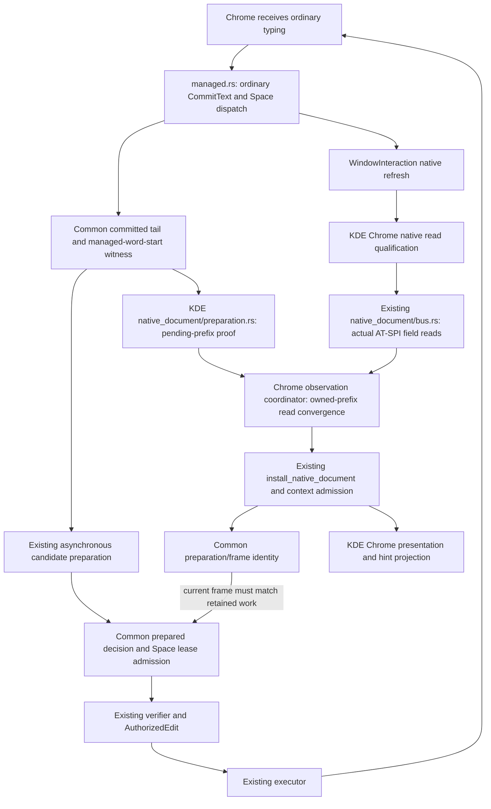

# One task: KDE Chrome observation of an owned append

Status: dependency map and preflight written before runtime edits, 2026-10-28.
Completion: selected fix verified; source3555/3555, short native8/8, full Chrome
179PASS/0FAIL/41BLOCKED. Per-case coverage movement remains explicitly recorded.
Only the Chrome stale-document/Space failure is in scope. Firefox, terminal
rendering, other browser failures and another release series are separate work.

## Baseline and observed failure

- Canonical checkout: `lay-dependency-updates-20261027`, branch
  `codex/browser-matrix-repair-20261027`, clean source baseline
  `32d073687ae8d631042ba127148dcaf492a394d1`.
- Installed remote KDE engine independently rechecked at task start: PID
  3228031, SHA-256
  `159435bd88be77b5aa0ffef217d64b168785f7190da46dec6f43b9543d1a09a5`,
  public source release 1.0.111. Local GNOME is not installed or restarted.
- Original immutable r19 browser receipt:
  `/home/e/projects/lay-development-runner/kde-install-control-20261020/isolated-release111-full-native-v1/chrome/chrome/row-37-native-trace.jsonl`.
  Matrix case: normal / tel / space-en-ru, expected `привет `, actual `ghbdtn `.
- Original Chrome matrix: 178 PASS / 1 FAIL / 41 BLOCKED, 220 cases. Firefox:
  125 PASS / 56 FAIL / 39 BLOCKED. These are baseline results, not new checks.

Measured trace sequence (zero-based original JSONL rows):

| Row | Observation | Meaning |
| --- | --- | --- |
| 560–561 | actual cursor 5; tail 5; exact managed readout | The preceding five-letter prefix is current. |
| 567 | printable managed commit `n`; tail 6 | Lay records the sixth ordinary key through the existing input path. |
| 585 | owned append resample, reason `older_owned_prefix` | The first actual native read still precedes that commit. |
| 586–589 | read succeeds in 18,502 microseconds; cursor 5, tail 6; exact managed false | The second actual read is still an older prefix. The old coordinator returns it because it has exhausted its one resample. |
| 592 | correction `identity_mismatch` | The existing freshness check refuses a candidate tied to a different complete input frame. |
| 598 | fallback commits one Space | Final field is `ghbdtn `; no unsafe replacement was performed. |

The first demonstrated defect is handing an unresolved owned-prefix observation
back to preparation after the fixed second read. This is not evidence that
ranking, verifier authority, telephone purpose policy or text delivery should
change. A deterministic source RED and a new native reproduction are still
required to establish the proposed repair's scope.

## Actual dependency and authority map

Concrete file chain (short names below are relative to
`src/bin/lay_ibus_engine/`; shared library paths start with `src/`):

```text
managed.rs: ordinary input
  ├─→ committed_tail.rs → space_autocorrect_prefetch.rs → src/ime_correction.rs
  └─→ kde/native_document.rs → kde/native_document/bus.rs
        → kde/chrome/observation.rs
                          ↓
preedit.rs + committed_tail.rs: exact current frame / prepared candidate lease
                          ↓
src/text_edit/structural_verifier.rs + src/text_edit/gate.rs
                          ↓
src/text_edit/executor.rs: AuthorizedEdit
  → window_interaction/execution.rs: revalidate and execute current target
  → output.rs: existing IBus output operations
```

The candidate worker can run before the actual field read settles. Both
branches must meet at the exact frame/lease check; this is a dependency map,
not an instruction to recompute candidates in the verifier. The native range
route's additional source/range checks remain in `kde/native_document.rs`.



| File / owner | Responsibility and downstream effect | Change boundary |
| --- | --- | --- |
| `managed.rs` | Ordinary key/Space handling invokes current refresh and correction contracts. | Protected: no changes. |
| `window_interaction/observation.rs`, `preedit.rs` | Common word witness and exact frame identity; an actual observation can settle preparation. | Protected: no changes. |
| `context_admission.rs`, `context_admission/adapter.rs` | Sole current field/focus/word admission and stale-event ordering. | Protected: no changes. |
| `kde/chrome.rs` | Qualifies the actual Chrome process and activation timing. | Protected behavior: no changes. |
| `kde/native_document.rs` | Existing desktop/client dispatch, reader, install checks and native edit verification. Reader already rejects non-KDE, terminal, sensitive and non-Chrome clients. | Only mechanical import/call wiring of the extracted read coordinator. No reader, install or edit-condition changes. |
| `kde/native_document/bus.rs` | Actual native text/caret/selection observations. | Protected: no transport changes. |
| `kde/native_document/observer.rs` | Existing subscription and refresh ingress. | Protected: no extra observer/owner. |
| `kde/native_document/preparation.rs` | Proves a pending read is an older prefix of this exact owned append, with current admission/focus/lease/layout, no selection and no handoff. | Protected: reuse the existing predicate unchanged. |
| **`kde/chrome/observation.rs`** | **Destination for the existing read coordinator; only functional change site.** | Await a complete actual read while the existing pending proof holds and the original 80 ms deadline has not expired. Never publish projected text. |
| `kde/chrome/presentation.rs` | Presentation of already authorized output and separator reflow. | Protected: no appearance changes. |
| `committed_tail.rs`, `space_autocorrect_prefetch.rs` | Existing decision lease, full input-frame/certificate comparison and correction dispatch. | Protected: preserve the demonstrated `identity_mismatch` rejection. |
| `window_interaction/authority.rs`, `execution.rs`, native edit verification | Sole authorization and execution of replacement. | Protected: no new executor, fallback, selection method or retry of edits. |
| `gnome/`, `kde/terminal.rs`, daemon KDE focus modules | Other client/desktop behavior. | Protected: no code or launch-environment changes. |

The graph query supplied navigation, not a behavioral proof. The reader's
actual process/backend checks and the caller edges were checked in source;
`read_native_document()` is called by the existing refresh and its tests.

## Minimum isolation and proposed repair

1. Move the existing coordinator into `kde/chrome/observation.rs`, preserving
   its parent Rust namespace through `#[path]` and a private import. Prove the
   extracted function body is identical before changing behavior.
2. Keep a single original observation deadline. If an actual coherent read is
   still a proven older prefix of the locally owned append, obtain another
   actual read within that deadline. A tiny asynchronous yield prevents a busy
   loop; it does not renew the deadline or authorize an edit.
3. Preserve the existing single resample for `native_document_changed` on the
   first attempt. Other source errors, changed field, selection, sensitive
   content, lost admission and contradictory text remain immediate refusals.
4. Return an explicit deadline failure if the owned prefix never becomes
   current. Never return a projected complete word as an actual source receipt.
5. Keep this behavior physically in the KDE Chrome adapter. Do not duplicate
   common correction, ownership or delivery mechanisms to obtain isolation.

This is explicitly a **KDE/Chrome field-observation integration change**, not
correction-only work. The mechanical call seam in `kde/native_document.rs` is
disclosed even though non-Chrome routes already refuse that reader. No canon
rule or gate is weakened. No desktop settings/model provisioning, learning-data
cleanup/reset, local GNOME processes or unrelated services are modified.

Allowed source paths: `kde/chrome/observation.rs`, the mechanical
`kde/native_document.rs` seam, the existing `kde/native_document/tests.rs`,
and the canonical test inventory plus its unchanged zero-failure declaration's
manifest hash only if test identities change. The active
scope declaration and new owning ADR must list these before the runtime edit.
Map/ADR/verification documents and generated graph are documentation artifacts.

## Verification order — stop expanding at the first failure

1. Short causal RED: production coordinator gets two valid older-prefix reads
   followed by the complete actual word; old code returns the second old prefix.
   Assert output surface, exact original deadline, unchanged admission/scope,
   and no output/delete/edit before the observation is installed.
2. Mechanical extraction proof, then the smallest behavior change and short
   GREEN. Include never-settles/deadline, contradictory document, changed
   identity/selection/private/source-error and no-authority controls. Reuse the
   existing test executor and isolation; no model or live-data cleanup.
3. Run `kde-chrome` canonical component recipe. Check the complete source diff
   against the declared boundary. A source PASS is not native acceptance.
4. Before a remote install, validate artifact provenance and the existing
   keyboard-safe install procedure. Restart only the scoped existing engine as
   required by that procedure, not the desktop/global IBus or local GNOME.
5. Short native Chrome control: same tel failure plus an ordinary text field,
   consecutive words, unchanged phone-number input and ordinary held Shift;
   preserve actual field/loaded SHA/trace/latency evidence. Do not retry a FAIL
   to green or silently relax expectations.
6. Only after the short result is acceptable: long **Chrome-only** fixed 220-case
   proof and affected source gates. Keep FAIL/BLOCKED/NOT_TESTED explicit and
   compare the same immutable matrix. Do not rerun Firefox/terminal matrices
   merely to increase test counts.

Rollback is the original three runtime files and the saved remote engine bytes;
no alternate delivery route or configuration migration is introduced. A release
or publication is not a completion requirement for this single repair unless
separately requested.

## Intermediate evidence, before the long proof

- Mechanical extraction body byte equal:
  `12eec6ab9d6514a8f34500c2c54fb60200b74db788a7317cf2ff152d76cbb1dd`.
- CROOT `chrome-owned-append-red-v2/result.json`: three selected canonical source
  cases, 2 PASS / 1 expected FAIL. The settled append case needs three reads;
  original code returns after two. Compile plus execution 34.30 seconds.
- CROOT `chrome-owned-append-green-v1/result.json`: 3/3 PASS, 15.67 seconds
  including incremental compilation. Changed source-error/deadline test name
  accurately describes its contract; inventory counts/lanes/isolation unchanged,
  and the zero-known-failure declaration only updates its manifest hash.
- CROOT `chrome-owned-append-component-v2/result.json`: fmt PASS, AST graph and
  architecture PASS, canonical KDE Chrome 75/75 PASS in 19.90 seconds. Graph
  update took 53.09 seconds separately. Canonical and worker source SHA agree:
  `2ce6b24786bab558599a46345c9ec3583f419847420a1f37ebf5a08e93933c5e`.
- The first source launch was blocked before compilation by the unchanged
  12 GiB target budget; obsolete pre-2026-10-27 debug Lay artifacts (7.32 GB)
  were removed under the existing lease. Release binaries' hashes were checked
  unchanged. The original BLOCKED receipt is retained. An early component
  controller used the prior overlay as its new-ADR baseline; it was corrected
  to the actual canonical task baseline without changing the canon or guard.
- CROOT `chrome-owned-append-deployment-v1`: engine-only release artifact,
  zero compiler warnings, loaded PID3556137/SHA
  `8b84bf5b6c569550af8e4061ea4cca83e74382d243ae693aeb243a1e22a035d3`.
  Daemon, tray and protected desktop/IBus processes unchanged. Candidate still
  reports base version111 and has not been published.
- CROOT `chrome-owned-append-short-native-v1/result.json`: the six original r19
  cases PASS. One added phone fixture FAIL is retained: the received IBus
  keyval is61 (`=`), before any Lay conversion, while the fixture intended `+`.
  The corrected fixture uses physical Shift+Equals from the existing stock
  terminal qualification; it does not change expected phone text or Lay code.
  Number/held-Shift controls continue separately in short-native-v2, reusing
  the six unchanged original PASS cases. Long proof remains gated on them.

Here CROOT is the existing private remote evidence directory
`/home/e/projects/lay-development-runner/kde-install-control-20261020`.
These source/native scopes do not change the previously recorded Firefox or
terminal visual verdicts.

## Native result after the short gate

Short native v2: **8/8 PASS** (six original unchanged r19 cases plus the corrected
phone number and held-Shift controls). Held Shift lasted313.37ms and produced
`HELlo`; the phone input remained `+7 (912) 345-67-89`. No Lay source edit was
made to correct that extra fixture's missing physical modifier.

The long immutable r19 Chrome-only matrix then completed all220 unique cases:
**179 PASS / 0 FAIL / 41 BLOCKED / 0 NOT_TESTED**. Original normal/tel/Space
FAIL becomesPASS, actual text `привет `, observed latency87.20ms. Candidate
loaded SHA remains unchanged before/after; configuration is restored and no
keys remain held. Full run elapsed420.97 seconds. No Firefox or terminal native
matrix was run.

Compare individual identities as well as totals: private/email/roundtrip/active
moved PASS→BLOCKED with `native/DOM text disagreement`; fullscreen/email/rapid-five/
active moved BLOCKED→PASS. No new functional FAIL is observed. The blocked count
is unchanged **in aggregate**, not at every identity. These coverage movements
are recorded without retrying them to green or opening another runtime fix.

The full comparison, raw220 rows and both ordinary-control fixture revisions
remain in the private cache. Broader source verification follows this successful
short-to-long client sequence; it cannot establish native acceptance elsewhere.

## Final source and runtime verification

The broader remote development check completed **3555/3555 PASS**:
3519 correctness and36 package cases, including1117 IME cases. Official local
receipt `/home/ubu/.cache/lay/development/run-n2we7ij5/RESULT.json`, remote
`/home/e/projects/lay-development-runner/run-vkUi8t/tests/SUMMARY.json`.
Zero semantic/infrastructure failures;41 ignored and11 performance cases were
not executed by these lanes. Format and tooling self-tests alsoPASS. The whole
remote source-check cycle took547.44s; this broad check was performed only after
the short source/component/native checks and the long Chrome proof passed.

Final independent runtime receipt CROOT/chrome-owned-append-final-runtime-v1.json
verifies the same loaded candidate SHA, unchanged protected processes/config,
220 native cases, restored configuration and zero held keys. Source remains
1301files/SHA2ce6b24786bab558599a46345c9ec3583f419847420a1f37ebf5a08e93933c5e.
Only the three declared Rust files implement/test the extraction and repair.
The parent seam was reconstructed against the immutable base and proved equal
apart from the declared move/import/call/comment; native reader, install,
authority and output bodies were not rewritten.

Selected-fix status: COMPLETE. The remote engine is an explicitly unpublished
candidate of base version111; no additional stable release or local GNOME
installation was performed. Other native failures and blocked coverage remain
separate tasks. See the adjacent machine-readable verification record for
exact artifacts, statuses, measurements and limitations.
